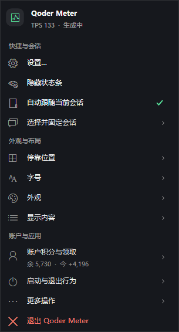
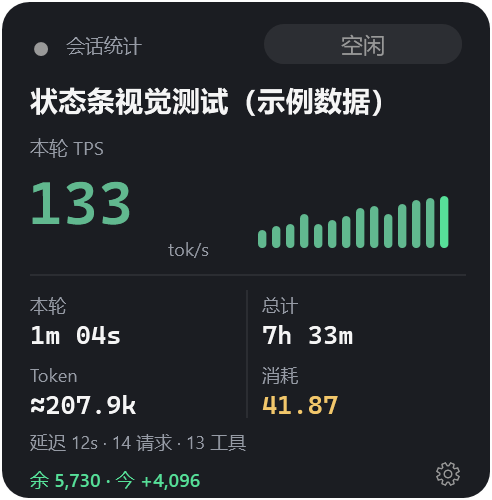
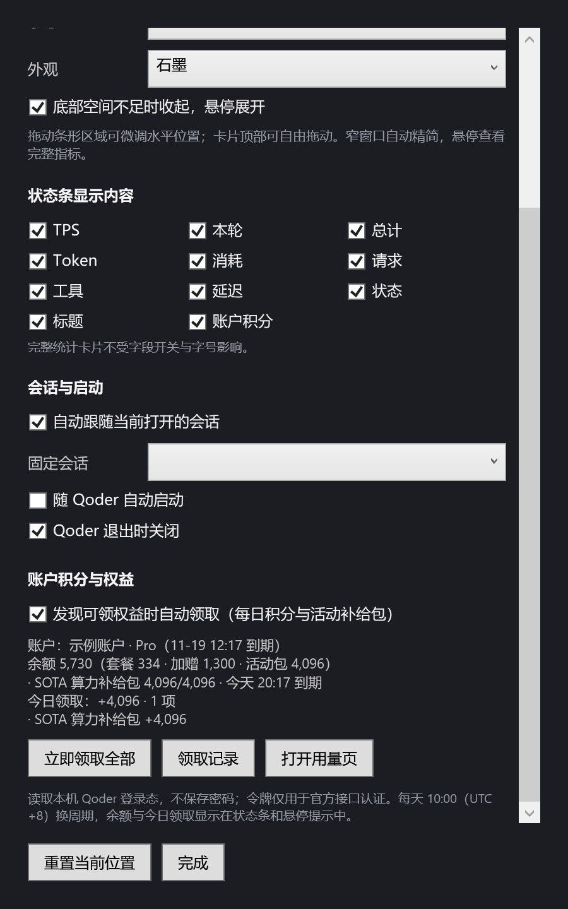

# Qoder Meter

给 Qoder Desktop 配一条轻量的会话状态条：查看生成速度、会话耗时、输出 Token 和积分消耗，不离开当前窗口。

这是第三方独立伴生应用，不是 Qoder 官方插件，也不修改客户端。macOS 使用 JXA + AppKit，Windows 使用 PowerShell + WPF；两个平台分别维护，功能并不完全相同。

[Windows 使用说明](windows/README.md) · [macOS 使用说明](macos/README.md) · [GitHub Releases](https://github.com/chenleshu/qoder-meter/releases)

## 本次源码更新

- **字段分隔线**：Windows 与 macOS 条形布局使用低对比度细竖线，分隔线纳入宽度计算，并与所依附的字段一起显示或隐藏。
- **稳定条形宽度**：两端按启用字段、字号和可用空间预留容量，运行中的数字、标题、TPS、计时和账户文案只更换槽位内文字，不改变外框或相邻列位置；空间或配置变化时才重算。
- **Windows 图文菜单**：右键与托盘菜单按快捷会话、外观布局、账户应用分组，使用系统线性图标、停靠位置示意图、主题色块和账户摘要；字段开关分为速度与时间、用量与账户、会话与活动三组。
- **Windows 账户功能内置**：余额读取、权益领取、领取历史不再依赖外部脚本；正常状态下显示 `余 5,730 · 今 +4,096`，无本机领取记录时显示 `今 +0`。有待领权益、领取中或账户异常时仍优先显示相应状态。
- **说明与截图整理**：按平台列出能力、安装方式和数据口径；Windows 图片由当前源码的真实 WPF 控件离线渲染，全部使用示例数据。

这批更新位于 `restructure` 分支，属于源码更新，不等于已经发布新的安装包。下方安装命令显式拉取该分支。

## 界面预览

### Windows：深色与浅色状态条


窄空间下隐藏次要字段，对应的分隔线同步移除：


Windows 右键与托盘使用同一套图文分组菜单，保留原生键盘导航、子菜单与勾选反馈：



<table>
  <tr>
    <td width="40%" align="center"><br>完整统计卡片</td>
    <td width="60%" align="center"><br>账户设置与领取入口</td>
  </tr>
</table>

以上是 Windows 真实控件的 2× 离线渲染，不包含真实会话或账户信息。macOS 未变化的卡片与统计面板原生截图见[平台说明](macos/README.md#界面预览)；采用新分隔线与固定容量宽度的 macOS 条形布局仍需在 Mac 上生成原生截图，不能把 Windows 图片当作 macOS 实测结果。

## 平台与功能

| 能力 | Windows | macOS |
| --- | --- | --- |
| 当前源码内应用版本号 | 1.4.0-win.3 | 1.5.2 |
| 系统 | Windows 11 已开发验证；Windows 10 2004+ 待完整验收 | macOS 13+ |
| 实现 | Windows PowerShell 5.1、WPF、系统 DLL | JXA、AppKit、系统构建工具 |
| 会话指标、细竖线、稳定宽度、主题、字号 | 支持 | 支持 |
| 自动跟随 / 固定会话 | 支持 | 支持 |
| 停靠位置 | 标题栏、会话工具栏、输入框下方、完整卡片 | 标题栏、窗口上方、窗口下方、侧栏卡片 |
| 按天 / 按模型消费统计 | 尚未移植 | 支持 7 天、近 30 天、本月、近一年 |
| Token 单位切换 | 当前采用 k / m 等缩写 | 支持 b / m / k 与 亿 / 万 |
| 账户余额与权益领取 | 支持，需联网 | 暂不支持 |
| 领取记录 | 本机记录，最多 400 条 | 暂不支持 |
| 手动检查更新 | 只接受兼容的 Windows 发布资产 | 检查 macOS 发布版本 |

两个版本号独立推进。不要将某个平台的截图、用量面板或账户能力理解为另一个平台也已经具备。

## 快速开始

### Windows

> Windows 版启动后会读取本机 Qoder 登录态并查询账户。源码默认开启自动领取可领权益；可在设置中关闭自动领取，但关闭后仍会查询余额和活动。请先阅读[账户行为与数据口径](windows/README.md#账户积分与权益)。

```powershell
git clone --branch restructure https://github.com/chenleshu/qoder-meter.git
cd qoder-meter\windows
powershell -NoProfile -ExecutionPolicy Bypass -File install.ps1 -NoAutoStart -StartNow
```

安装目录为 `%LOCALAPPDATA%\QoderMeter\app`。`-NoAutoStart` 表示保留已有自启动配置、不新增启动守护，不会替已开启自启动的用户关闭它。也可使用 `windows/启动 Qoder 状态条.cmd` 直接运行源码。

### macOS

```bash
git clone --branch restructure https://github.com/chenleshu/qoder-meter.git
cd qoder-meter/macos
./install.sh
```

构建并安装到 `~/Applications/QoderMeter.app`。使用 macOS 自带工具，不要求 Node 或 Python；消费统计面板需要可用的 `jq`。应用采用本地 ad-hoc 签名，未经过 Apple 公证，首次打开可能需要在系统安全设置中确认。

## 日常使用

- **打开设置**：点击齿轮；Windows 也可左键点击托盘图标，macOS 可从菜单栏进入。
- **选择布局**：条形视图适合常驻查看，卡片适合完整摘要。每个布局独立记忆位置，重置只影响当前布局。
- **调整密度**：开关条形视图字段、选择四档字号。完整卡片仍为固定排版，不受条形字段开关和字号影响。
- **查看详细数据**：悬停状态条查看会话、模型、指标与诊断；Windows 还包含余额构成、领取和有效期。
- **切换会话**：默认自动跟随打开的会话，也可选择并固定；固定后需恢复自动跟随才能继续自动切换。
- **控制启动**：自启动、随 Qoder 退出均可设置。手动退出会抑制当前 Qoder 进程生命周期内的自动拉起。

## 指标怎么读

| 指标 | 含义与边界 |
| --- | --- |
| TPS | 本轮匹配到的输出量 / 模型请求耗时，不是瞬时解码速度或网络测速 |
| 本轮 | 当前轮的经过时间 |
| 总计 | 从会话创建到现在的时间，不等于持续工作时长 |
| Token | 会话输出量；模型缺少精确值时按文本、思考及工具参数估算，估算展示带 `≈` |
| 积分 / 消耗 | 本地账单中记录的会话 Credits，不等于账户余额变化 |
| 延迟 | 最近一次模型请求耗时，不是首 Token 延迟 |
| 余额（Windows） | 套餐、加赠与有效活动包剩余合计；专属活动积分不一定适用于所有模型 |
| 今日领取（Windows） | 本机 Meter 记录的当前权益周期领取积分；UTC+8 每天 10:00 换周期，不是跨设备完整账单 |

当前混合精确 / 估算输出的会话仍优先展示已有精确累计部分，不应据此认定覆盖了全会话的全部输出。请勿将估算 Token 当作官方计费依据。

## 数据与隐私

两端只读 Qoder 的数据库、会话 JSONL 和 segment 日志，不修改客户端、不上传会话内容、无遥测。工具自身会保存设置、日志和必要缓存。

- **macOS**：联网仅在手动检查更新时访问 GitHub；消费统计缓存保存在本机。
- **Windows**：另会向 `openapi.qoder.sh` 查询余额、活动及提交领取。登录令牌从本机安全存储读取，只在内存中使用并用于官方账号接口认证，不保存账号密码。关闭自动领取不等于关闭账户联网功能。

## 验证与已知限制

- Windows 的语法检查、界面 / 设置 / 交互回归、模拟账户测试及离线截图命令见[Windows 验证说明](windows/README.md#开发与验证)。测试夹具不会触发真实领取。
- macOS 的原生构建、离线布局回归与截图说明见[macOS 开发与验证](macos/README.md#开发与验证)。Windows 无法验证 AppKit 的原生字体、窗口行为或签名构建。
- 停靠并非 Qoder 原生插槽。客户端布局、缩放或侧栏宽度变化后可能需要微调；多窗口、混合 DPI 多显示器和中国区客户端仍有待完整验收的场景。
- 本地数据格式与账号接口可能随 Qoder 升级变化；大日志首次扫描及 Windows 同步账户请求可能导致短暂卡顿。

## 项目结构

```text
macos/      JXA 主程序、构建安装脚本、探针与 macOS 截图
windows/    PowerShell / WPF 实现、安装卸载、回归与 Windows 截图
.github/    macOS 构建与 Windows 语法检查工作流
```

本项目与 Qoder 官方无关联。[MIT License](LICENSE)。
