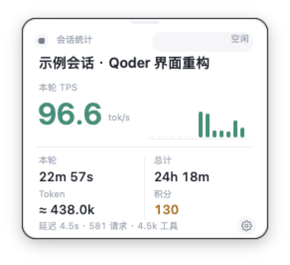
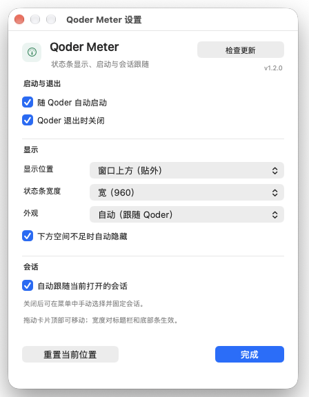
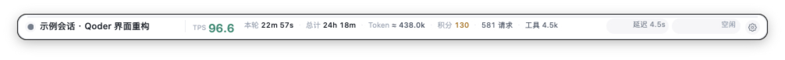
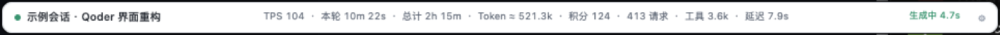

# Qoder Meter

> macOS 上给 Qoder 用的伴生状态条：实时显示当前会话的 TPS、本轮与总计时长、输出 Token、积分、请求数、工具调用和延迟，并跟随你当前打开的会话切换。

Qoder Meter 是一个轻量的 macOS 菜单栏/浮窗工具，用只读方式读取 Qoder 本地数据，在 Qoder 窗口的侧边栏、标题栏、窗口上方或窗口下方显示当前会话的实时指标。它不修改 Qoder，默认不联网，也不会上传任何会话内容；只有你点击设置里的「检查更新」时，才会访问 GitHub Releases 获取版本号。

> **不是 Qoder 官方插件。** Qoder 当前的 app plugin API 只开放工作区、设置页、会话资源侧栏和文件预览等视图，没有底部状态栏或侧边栏小挂件的插槽。因此本项目以独立伴生应用的形式实现，外观和操作尽量贴近 Qoder 的界面。


---

## 截图

<table>
  <tr>
    <td align="center" width="50%">
      <br>
      <sub>侧边栏卡片（可拖动、默认位置）</sub>
    </td>
    <td align="center" width="50%">
      <br>
      <sub>独立设置窗口（浮在 Qoder 之上）</sub>
    </td>
  </tr>
</table>

<p align="center">
  <br>
  <sub>窗口上方（贴外）：Qoder 窗口正上方、左对齐，左端在 Dock 访达图标左侧</sub>
</p>

<p align="center">
  <br>
  <sub>窗口标题栏内嵌：单行指标融入标题栏，不覆盖聊天区</sub>
</p>

<p align="center">
  <br>
  <sub>窗口下方（贴外）：贴在 Qoder 窗口外侧下方，不压输入框</sub>
</p>

> 截图中的会话名称和数值为演示数据，不包含真实用户会话。

## 功能

- **四种显示形态**
  - `侧边栏卡片`：放在 Qoder 左侧栏空白区，可拖动，位置按布局记忆。
  - `窗口标题栏（融入顶部）`：单行状态贴在 Qoder 标题栏右侧，不覆盖聊天内容。
  - `窗口上方（贴外）`：贴在 Qoder 窗口正上方外侧，与窗口左边缘对齐（左端在 Dock 访达图标左侧）；窗口上方空间不足时回退到标题栏内嵌。
  - `窗口下方（贴外）`：贴在 Qoder 窗口外侧下方；窗口下方空间不足时自动收成一条 4px 细线，悬停展开。
- **实时指标**
  - 当前轮 TPS，以及最近 14 次请求的迷你趋势。
  - 本轮时长 / 会话总时长。
  - 会话输出 Token（当前模型不返回 token 时为估算值，标注 `≈`）。
  - 已用积分（精确值）。
  - 请求数、工具调用数、最近请求延迟。
  - 模型、生成中/本轮中/空闲状态。
- **跟随当前会话**
  - 读取 Qoder 本地 `lastRoute`，跟随你正在打开的会话，而不是“最近一次提问”的会话。
  - 也可以在菜单里固定某个会话；设置窗口可恢复自动跟随。
- **可调宽度**
  - `紧凑 640` / `标准 800` / `宽 960`，对标题栏、窗口上方和下方状态条生效。
- **外观与位置**
  - 浅色 / 深色卡片。
  - 侧边栏卡片可拖动；标题栏条可横向拖动；位置持久化，并可重置。
  - Qoder 不在最前台时，卡片和状态条自动隐藏；回到 Qoder 后恢复显示。
- **启动与退出**
  - 随 Qoder 自动启动（LaunchAgent 守护）。
  - Qoder 退出时自动关闭（可关闭）。
  - 手动退出后本次 Qoder 会话内不会反复拉起，下次 Qoder 启动会再出现。
- **设置入口**
  - 卡片右下角齿轮。
  - 标题栏/下方状态条右端齿轮。
  - 菜单栏 `◉ TPS` → `设置…`。
- **检查更新**
  - 设置窗口右上角显示当前版本，点击「检查更新」才会访问 GitHub Releases。
  - 有新版本时按钮变为「获取更新」，打开对应 Release 页面。
- **只读、本地、默认离线**
  - 不发送会话数据，不包含遥测；联网仅限手动检查更新。

## 环境要求

- macOS 13 或更高版本（Apple Silicon / Intel）。
- Qoder macOS 桌面版（开发时基于 `0.4.11` 测试）。
- 不需要安装 Node、Python 或其他运行时；构建只依赖 macOS 自带的 `osacompile`、`PlistBuddy` 和 `codesign`。

## 快速开始

```bash
git clone https://github.com/chenleshu/qoder-meter.git
cd qoder-meter
./build.sh
open QoderMeter.app
```

或者安装到用户的应用目录：

```bash
./install.sh
```

`install.sh` 会构建并复制到 `~/Applications/QoderMeter.app`，然后启动。

> 本项目使用 ad-hoc 本地签名，没有经过 Apple 公证。如果 macOS 首次阻止打开，请在“系统设置 → 隐私与安全性”中允许，或右键应用选择“打开”。

## 使用

### 打开设置

- 点击卡片右下角的 **齿轮**；
- 或点击标题栏/下方状态条右端的 **齿轮**；
- 或点击菜单栏的 `◉ TPS` → **设置…**。

设置窗口可以调整：

- 随 Qoder 自动启动
- Qoder 退出时关闭
- 显示位置（侧边栏 / 标题栏 / 窗口上方 / 窗口下方）
- 状态条宽度（640 / 800 / 960）
- 外观（浅色 / 深色）
- 是否在下方空间不足时自动隐藏
- 自动跟随当前打开的会话
- 检查更新（显示当前版本，按需访问 GitHub Releases）
- 重置当前位置

### 显示形态

| 形态 | 位置 | 遮挡情况 |
| --- | --- | --- |
| 侧边栏卡片 | Qoder 左侧栏空白区 | 不遮挡聊天区；卡片可拖动 |
| 窗口标题栏 | Qoder 标题栏右侧 | 不覆盖聊天内容 |
| 窗口上方（贴外） | Qoder 窗口正上方外侧，左对齐 | 不覆盖聊天区；空间不足时回退到标题栏 |
| 窗口下方（贴外） | Qoder 窗口外侧下方 | 不压输入框；空间不足时自动隐藏为细线 |

### 会话跟随

默认自动跟随 Qoder 当前打开的会话。切换会话后约 1–2 秒内更新。

如果从菜单里“选择会话”固定了某个会话，自动跟随会暂停；在设置里重新勾选“自动跟随当前打开的会话”，或点击菜单里的对应项即可恢复。

### 自动启动

开启“随 Qoder 自动启动”后，会安装一个用户级 LaunchAgent：

- `~/Library/LaunchAgents/com.qoder.meter.watch.plist`
- `~/Library/Application Support/QoderMeter/watch.sh`

守护脚本每几秒检查 Qoder 是否运行：Qoder 启动时拉起 Qoder Meter；Qoder 退出时按设置决定是否关闭。关闭此选项会卸载并删除守护脚本。

如果移动了 `QoderMeter.app` 的位置，请关闭再打开一次“随 Qoder 自动启动”，让守护脚本更新路径。

## 数据来源

全部为**本地只读**：

- `~/Library/Application Support/com.qoder.app.stable/main.sqlite`：会话、上下文统计、模型等。
- `~/.qoder/projects/.../<session>.jsonl`：每条助手消息、积分、Token 字段。
- `~/.qoder/logs/sessions/.../<session>/segments/*.jsonl`：模型请求起止时间、本轮边界。
- `~/Library/Application Support/com.qoder.app.stable/Local Storage/leveldb`：当前打开会话的 `lastRoute`。

不会写入 Qoder 的数据库或日志。

## 指标口径

| 指标 | 来源/口径 |
| --- | --- |
| 本轮 TPS | 本轮各次模型调用的输出量 / 耗时加权平均，含思考与工具参数 |
| 本轮时长 | 当前轮从开始到最近活动或现在的时长 |
| 总计 | 从会话创建至今的时长 |
| Token | 会话输出 Token；模型返回精确值时用精确值，否则按中英文字符和工具参数估算 |
| 积分 | Qoder 本地 usage 中的 credits，精确值 |
| 请求 / 工具 / 延迟 | 模型请求数、tool_use 调用数、最近一次模型请求耗时 |

Qoder 的 `dfmodel` 在本地日志中返回的 `output_tokens` 为 0，因此在这种情况下 TPS 和 Token 是估算值，界面中用 `≈` 标注。换成会返回精确 token 的模型时会自动使用精确值。

延迟字段固定在状态条右侧，不参与中间指标的截断，窄宽度下也会保留；如果当前轮还没有已完成的模型请求，会显示 `延迟 —`，等首次请求完成后自动填上。

上下文占用百分比**不显示**，因为 Qoder 输入框已经自带该信息。

## 隐私

- 默认不发起网络请求，不包含遥测或账号上传。
- 只有点击「检查更新」时，才会向 `api.github.com` 请求最新 Release 的版本号与链接；不发送会话数据。
- 不上传会话标题、消息内容、Token 或积分。
- 所有数据仅在本地进程内存中处理。
- 截图使用演示会话名与演示数据。

## 已知限制

- **不是 Qoder UI 插件**：Qoder 当前没有底部状态栏/侧边栏挂件插槽，因此这是独立伴生应用。
- 上方“贴外”模式依赖 Qoder 窗口上方有可用空间；窗口贴近菜单栏或全屏时会回退到标题栏内嵌。
- 下方“贴外”模式依赖 Qoder 窗口下方有可用空间；全屏或贴近 Dock 时会切换为自动隐藏的底部细线。
- 标题栏模式依赖常规窗口标题栏；全屏时可能覆盖顶部工具栏，建议改用侧边栏或下方模式。
- 侧边栏卡片宽度受 Qoder 侧边栏限制；宽度设置主要作用于标题栏、上方和下方状态条。
- 宽度目前提供三档预设，不是自由拖拽改宽。
- 如果同时打开多个 Qoder 窗口，`lastRoute` 可能反映最后一次导航的窗口，而不是当前焦点窗口。
- 仅支持 macOS。

## 卸载

```bash
./uninstall.sh          # 移除应用和 LaunchAgent
./uninstall.sh --purge  # 同时删除设置与日志
```

或在设置中关闭“随 Qoder 自动启动”，退出应用后手动删除：

- `~/Applications/QoderMeter.app`
- `~/Library/LaunchAgents/com.qoder.meter.watch.plist`
- `~/Library/Application Support/QoderMeter`
- `~/Library/Logs/QoderMeter.log`

## 开发

```bash
./build.sh
```

核心文件：

- `src/main.js`：JXA + AppKit 应用逻辑（数据读取、UI、设置窗口、守护配置）。
- `build.sh`：使用 `osacompile` 构建 `.app`，写入 Info.plist 并 ad-hoc 签名。
- `docs/screenshots/`：README 演示截图。

项目使用 macOS 自带的 JavaScript for Automation（JXA），不依赖外部 npm 包。

## 免责声明

Qoder Meter 是第三方开源工具，与 Qoder 官方无关联。它只读取本地数据，不修改 Qoder；Qoder 版本升级后本地数据结构可能变化，届时可能需要更新解析逻辑。

## License

[MIT](LICENSE)
