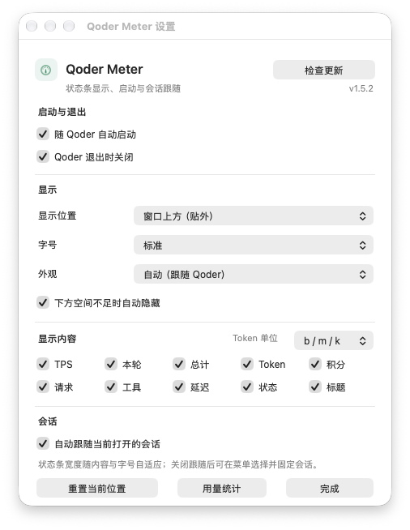
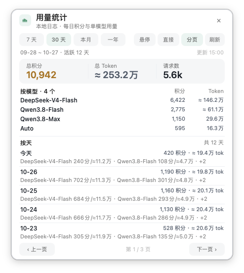

# Qoder Meter for macOS

Qoder 的第三方伴生状态条，使用 macOS 自带的 JXA + AppKit 实现。只读本地会话数据，不修改 Qoder 客户端；默认离线，手动检查更新时才访问 GitHub。

[项目总览](../README.md) · [Windows 版](../windows/README.md) · [Releases](https://github.com/chenleshu/qoder-meter/releases)

## 本次源码更新

- **字段细竖线**：标题栏、窗口上方和窗口下方的条形布局使用原生 `NSBox` 分隔线，替换指标间的圆点；线宽 1pt、高度随字号缩放，使用当前皮肤灰色的 35% 不透明度。
- **测量与显示一致**：每个指标使用独立文本控件，分隔线占用的宽度计入布局。关闭字段或窄窗口隐藏字段后重新生成相邻分隔线，不留下首尾孤立线；单字段不加分隔线，统计和设置按钮不加尾线。
- **窄宽整项精简**：先从工具、请求等后部指标开始裁减；空间进一步不足时缩短或隐藏标题及其他字段。完整数值可在悬停提示中查看。
- **可复现验证**：新增跨平台离线布局回归，以及仅在 Mac 图形会话运行的原生 PNG 渲染探针。侧栏卡片、统计面板和设置布局未因本次分隔线更新改变。

当前更新位于 `restructure` 分支，源码版本号仍为 `1.5.2`；本次没有发布新安装包。已有 Release 不一定包含这些修改。Windows 的账户余额与权益领取是独立功能，**本次没有移植到 macOS**。

## 界面预览

以下是仓库已有的 macOS 原生演示图，用于展示本次未变化的卡片、设置和用量统计，**不是新分隔线的实测截图**。

<table>
  <tr>
    <td align="center" width="50%">
      <br>
      <sub>固定排版的完整统计卡片</sub>
    </td>
    <td align="center" width="50%">
      <br>
      <sub>位置、字号、皮肤、Token 单位与字段开关</sub>
    </td>
  </tr>
</table>

<p align="center">
  <br>
  <sub>用量统计：范围选择、模型汇总和按天分页</sub>
</p>

本次修改在 Windows 环境完成，尚未取得新版条形布局的 AppKit 原生截图。旧的 `title-bar@2x.png`、`top-bar@2x.png`、`bottom-bar@2x.png` 保留作历史素材，不用于展示本次分隔线效果。可按下方「开发与验证」运行原生探针生成新版图；Windows 平台截图不能作为 Mac 实测结果。

## 安装与升级

要求 macOS 13+、Qoder macOS 桌面版。既有开发适配基于 Qoder Desktop `0.4.11`，新版客户端及不同显示器布局仍需实机检查。

```bash
git clone --branch restructure https://github.com/chenleshu/qoder-meter.git
cd qoder-meter/macos
./build.sh
open QoderMeter.app
```

安装到用户应用目录并启动：

```bash
./install.sh
```

默认安装位置为 `~/Applications/QoderMeter.app`；可通过 `QODER_METER_INSTALL_DIR` 指定其他目录。升级前先退出旧的 Qoder Meter，再重新构建、安装，避免仍在运行旧副本。

运行和构建不依赖 Node/Python；构建使用 macOS 自带的 `osacompile`、`PlistBuddy` 和 `codesign`。用量统计另外需要可用的 `jq`，可用 `command -v jq` 检查；缺失时自行安装，例如 `brew install jq`。缺少 `jq` 的空统计结果不代表没有消耗。

应用使用 ad-hoc 签名，未经过 Apple 公证。首次被系统阻止时，可在「系统设置 → 隐私与安全性」中检查并允许，或右键应用选择「打开」。

## 显示与交互

| 形态 | 位置与行为 |
| --- | --- |
| 侧边栏卡片 | 左侧栏空白区，可拖动；固定完整排版，不随状态条字段开关和字号改变 |
| 窗口标题栏 | 标题栏右侧紧凑条，可横向微调；不是 Qoder 原生插槽，可能与客户端工具区域重叠 |
| 窗口上方 | 贴在窗口外侧上方；上方空间不足时转为标题栏紧凑条，全屏时收为顶部细线 |
| 窗口下方 | 贴在窗口外侧下方；启用自动隐藏后，空间不足时收为底部细线，全屏也使用边缘细线 |

边缘细线可悬停展开。Qoder 不在前台时浮层隐藏，回到 Qoder 后恢复。位置按布局记忆，可从设置重置当前布局；侧栏没有空白区时，建议改用条形布局而非遮住会话列表。

点击状态条或卡片的齿轮打开设置，也可从菜单栏入口打开。可配置：

- 五套皮肤：纸白、石墨、海盐、暮色、暖砂，另有自动外观；自动优先读取 Qoder 的图标外观投影，失败时跟随系统，不保证等同编辑区主题。
- 小、标准、大、特大四档字号；条形布局高度与宽度同步调整，卡片保持固定排版。
- TPS、本轮、总计、Token、积分、请求、工具、延迟、状态、标题逐项开关。标题字段不在标题栏紧凑模式显示。
- Token 单位在 `b / m / k` 与 `亿 / 万` 之间切换，状态条、卡片和统计面板同步生效。
- 自动跟随当前会话，或从菜单选择并固定会话。恢复自动跟随后解除固定；通常约 1–2 秒更新，读取大型日志时可能更慢。

条形宽度由启用字段、字号和可用空间计算。窄窗口隐藏整个字段，不在分隔线中间截断；字段内部遇到超过预留宽度的长值仍会省略。悬停提示保留完整摘要，不应仅凭被隐藏的字段判断数据缺失。

## 用量统计

从齿轮旁的统计图标、设置里的「用量统计」或菜单栏打开。统计来自本地日志，**不是账号余额，也不包含权益领取状态**。

- 范围：7 天、近 30 天、本月、近一年。
- 汇总：积分、输出 Token、请求数，按模型和日期拆分；模型名优先使用 Qoder 自带标签，未知模型保留原标识。
- 悬停显示：移入统计图标展开，移开收起，点击可固定。
- 直接显示：常驻摘要、模型汇总和最近 5 天。
- 分页显示：常驻面板，每页 5 天，可前后翻页。

结果缓存约 10 分钟；面板「刷新」可重新扫描。统计覆盖本机留存且能够解析的日志，不等同账号的跨设备账单。模型未返回精确输出量时 Token 为估算值，使用 `≈` 标记。

## 自动启动与退出

「随 Qoder 自动启动」默认关闭。开启后创建用户级 LaunchAgent，检测 Qoder 运行时启动 Meter：

- `~/Library/LaunchAgents/com.qoder.meter.watch.plist`
- `~/Library/Application Support/QoderMeter/watch.sh`

「Qoder 退出时关闭」可单独设置。主动退出 Meter 后，本次 Qoder 进程生命周期内不会被守护反复拉起。应用位置改变后，应关闭再开启自动启动，以更新守护路径。

## 数据与指标口径

| 来源 | 用途 |
| --- | --- |
| `~/Library/Application Support/com.qoder.app.stable/main.sqlite` | 会话、标题、模型、创建时间及上下文快照 |
| Qoder 的 `Local Storage/leveldb` | 当前会话 `lastRoute` |
| `~/.qoder/projects/…/<session>.jsonl` | 积分、输出内容、请求与工具调用 |
| `~/.qoder/logs/sessions/…/segments/*.jsonl` | 本轮边界、模型请求开始和完成时间 |

Qoder 数据均为只读；Meter 自己的设置和统计缓存存放在 `~/Library/Application Support/QoderMeter/`，运行日志为 `~/Library/Logs/QoderMeter.log`。

| 指标 | 含义与边界 |
| --- | --- |
| TPS | 匹配的本轮输出量 / 模型请求耗时，不是每秒采样的瞬时速度；模型不返回精确 Token 时使用估算 |
| 本轮 | 当前轮开始至最近活动或现在的时长 |
| 总计 | 会话创建至今的时间跨度，包含空闲，不代表实际工作时长 |
| Token | 会话累计输出，包括文本、思考和工具参数；精确输出不可用时按 `CJK/1.35 + 其他字符/3.8` 估算 |
| 积分 | 本地 usage 记录的 credits 消耗，不是剩余余额 |
| 请求 / 工具 | 模型请求数和工具调用数；macOS 工具数还可能采用上下文快照的统计 |
| 延迟 | 最近一次模型请求耗时，不是首 Token 延迟；未完成首次请求时显示 `—` |

精确和估算输出混合的会话仍有口径限制：当前摘要优先显示已取得的精确部分，不保证补齐其余估算量。TPS、Token、工具计数应结合数据来源理解，不用于计费核对。上下文占用不重复显示，因为 Qoder 自身已有对应提示。

## 隐私与联网

macOS 版不读取账号登录令牌，没有余额查询或权益领取。默认不联网、不包含遥测，也不上传会话标题、消息、Token 或积分；仅手动「检查更新」时请求 GitHub Release 元数据，随后由用户选择是否打开下载页面。更新检查不会自动安装应用。

本地统计会写入 Meter 的 `stats-cache.json`，因此不是「所有数据只在内存中」。卸载时可选择保留或删除设置、缓存和日志。

## 开发与验证

无需 npm 依赖的离线布局回归（需单独准备 Node.js）：

```bash
node --check src/main.js
node --check render-bar-probe.js
node bar-separators.test.cjs
```

本次已通过 **196,608 个布局组合、12,864 次真实源码 mock 控件构建**：覆盖全部 1,024 种字段开关、四档字号、两种 Token 单位、窄宽窗口和五种皮肤。测试拒绝非渲染 I/O，不执行应用主入口，不读取用户数据。它验证几何和控件组织，**不能替代 AppKit 字体、绘制与窗口行为实测**。

在 Mac 的已登录图形会话中生成原生条形示例图：

```bash
mkdir -p /tmp/qoder-meter-bars
osascript -l JavaScript "$PWD/render-bar-probe.js" \
  "$PWD/src/main.js" /tmp/qoder-meter-bars
```

探针读取指定源码、跳过 `main()`，用示例数据调用真实 AppKit 控件，将控件自身缓存为 PNG；不截取用户屏幕，不读取 Qoder 数据、不联网。输出包含深浅主题、三种条形布局、四档字号及空字段/单字段/窄宽案例；同名探针图片会被覆盖。该原生探针本次仅做语法检查，尚未在 Mac 执行。

原生构建：

```bash
./build.sh
```

提交前仍应在 Mac 检查深浅主题、字段开关、宽窄窗口、全屏边缘展开和多显示器位置。核心文件为 `src/main.js`；`build.sh` 负责生成并签名 `.app`。本次未改变版本号，分支更新不等于 Release 发布。

## 已知边界

窗口位置依赖 Qoder 的现有几何布局，而非官方插件插槽。客户端升级、界面缩放、不同 Dock 位置、多屏或混合缩放都可能需要重新调整停靠位置。多窗口时 `lastRoute` 可能来自最后导航的窗口，而非当前焦点窗口。

首次扫描大型日志可能短暂停顿；统计依赖本地日志完整性和 `jq`。macOS 条形布局的本次修改已完成离线回归，但尚未完成原生构建、运行与新版截图验收。

## 卸载

```bash
./uninstall.sh          # 移除默认位置应用和 LaunchAgent，保留设置
./uninstall.sh --purge  # 同时删除 Meter 设置、缓存和日志
```

自定义安装目录中的应用需自行删除；Qoder 本身及其会话数据不受影响。

License: [MIT](../LICENSE)。第三方开源工具，与 Qoder 官方无关联。
