# Qoder Meter for Windows

Windows PowerShell 5.1 + WPF 编写的 Qoder Desktop 伴生状态条。无需 Node / Python 运行时，不修改 Qoder 客户端；除状态条与账户信息外，也提供按日 / 周 / 月的本地用量统计。[返回项目首页](../README.md) · [macOS 版](../macos/README.md)

## 本次更新

1. 条形布局的指标、状态和账户胶囊之间加入 **1 DIP 细竖线**：高度随字号变化，使用主题灰色的 35% 不透明度，避免抢占数字的视觉重点。
2. 分隔线属于其右侧字段，字段关闭或因空间不足隐藏时会一起移除；所有字段关闭时不残留分隔线，设置按钮后不出现尾线。
3. 账户功能内置到 `lib-account.ps1`，正常状态显示剩余积分与本机今日领取；无需外部领取脚本。
4. 补充空活动列表缓存、领取失败冷却的回归，整理功能说明与离线截图。
5. Windows 右键与托盘菜单改为图文分组：系统线性图标、停靠位置示意图、主题色块和账户摘要，深浅配色随皮肤切换；字段开关进一步分成速度与时间、用量与账户、会话与活动三组。
6. 条形字段改为按内容自然宽度：不再为数字、计时或账户文案预留固定列位，短值和长值都不额外留白；数字变长时条形只扩展到实际需要，仍不超过可用空间。
7. 条形排版整体收紧：高度由 30 DIP 降到 26 DIP，缩小字段间距、分隔线间距、状态灯与胶囊内边距和设置按钮；默认关闭状态、工具、请求三项，保留 TPS、本轮、总计、Token、消耗、延迟与账户积分。
8. 关键指标自动着色：TPS 生成中为亮绿、空闲降为暗绿；输出 Token 使用主题蓝，本会话消耗使用主题金；请求耗时按 15 秒 / 30 秒分为绿、金、红三档，账户与领取状态沿用绿、金、红语义色。
9. 悬停详情改为与主界面同风格的主题卡片：状态圆点、会话标题与状态胶囊、模型信息、六格关键指标、请求汇总、账户余额与构成、活动包、今日领取明细和提示脚注；深浅皮肤、字号和 DPI 同步，更新时原位刷新文字与颜色，不重建弹层。
10. 设置与领取记录界面重构为分组卡片：账户摘要集中在卡片顶部，余额、套餐构成、活动包、今日到账与领取状态分层显示；按钮、复选、下拉框和滚动条统一使用跟随皮肤的主题样式。领取记录按天分组并从新到旧排列，标明当天合计、领取时间、到期时间与适用范围，无记录时显示空状态引导。
11. 本地用量统计改为图文仪表盘：状态条齿轮左侧新增图表入口，设置卡片也在「打开统计」旁显示迷你趋势预览。统计窗口分为「总览 / 明细」：总览显示积分、Token、请求、活跃天四张摘要卡，最多最近 12 期的柱状趋势、模型占比条，以及今天 / 近 7 天 / 本月 / 全部四条规则生成摘要；明细保留逐期分页。范围、粒度与视图均本机保存，数据仍只读会话 JSONL，不访问账户接口。

应用内版本号升到 `2.1.1`，与 macOS 侧共用同一条版本线；当前为源码更新，未单独生成新的 Release 安装包。

## 界面预览

### 标题栏：深色 / 浅色


### 窄空间：保留核心字段


### 紧凑宽度：短内容 → 超长内容


两图使用同一主题和字段配置。短内容不保留空列，超长数字只把条形扩展到实际需要的宽度，仍受可用空间限制；完整内容仍保留在悬停卡片中。

### 悬停详情：主题化卡片

<table>
  <tr>
    <td align="center">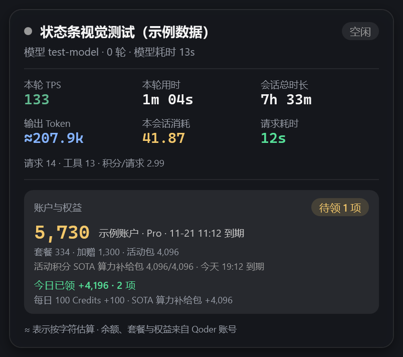<br>石墨主题</td>
    <td align="center">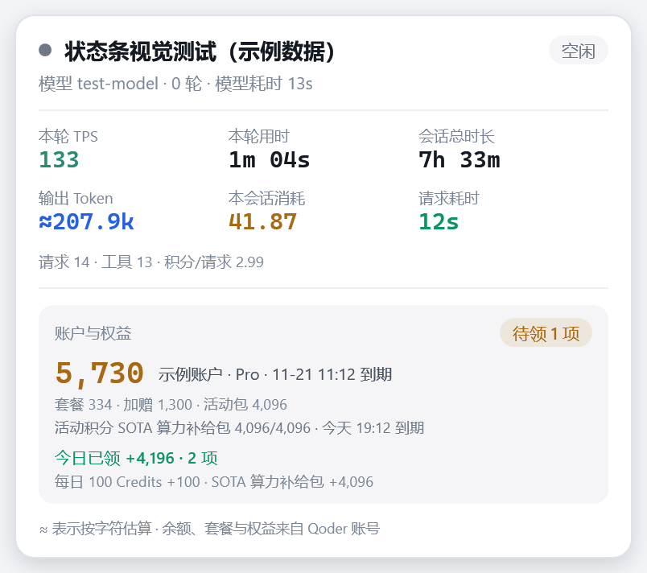<br>纸白主题</td>
  </tr>
</table>

卡片把指标、账户与领取信息分层排版：六格关键指标自动配色，账户区单独使用浅色底板，余额、套餐构成、活动包、今日领取与领取状态各占一行。窄空间隐藏的字段仍在此完整显示。

### 完整卡片、设置与领取记录

<table>
  <tr>
    <td width="34%" align="center">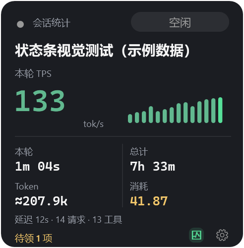<br>会话统计与账户摘要</td>
    <td width="66%" align="center">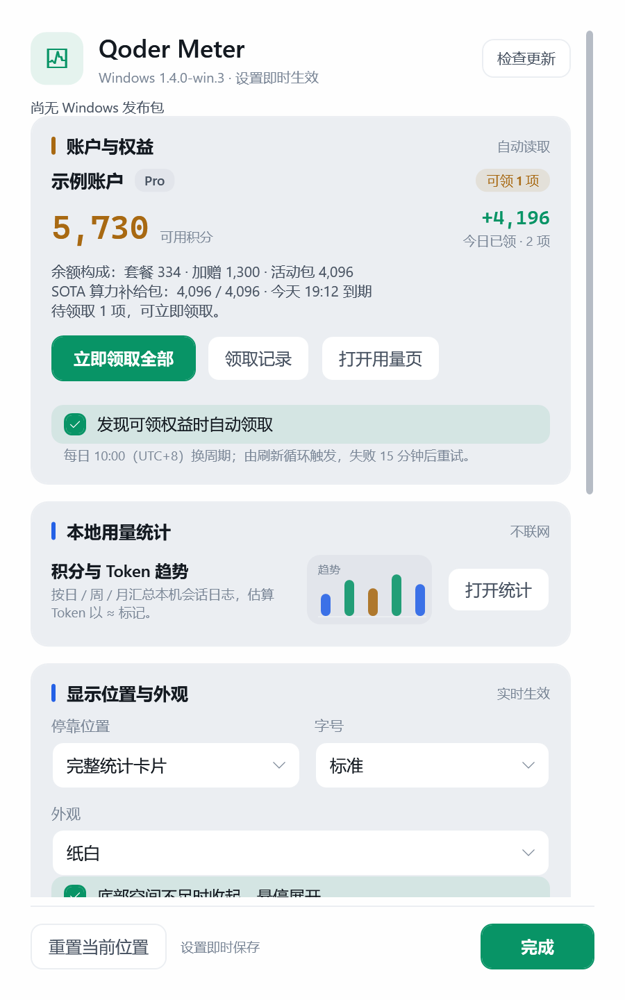<br>设置：账户、统计与外观分组卡片</td>
  </tr>
</table>

<table>
  <tr>
    <td align="center">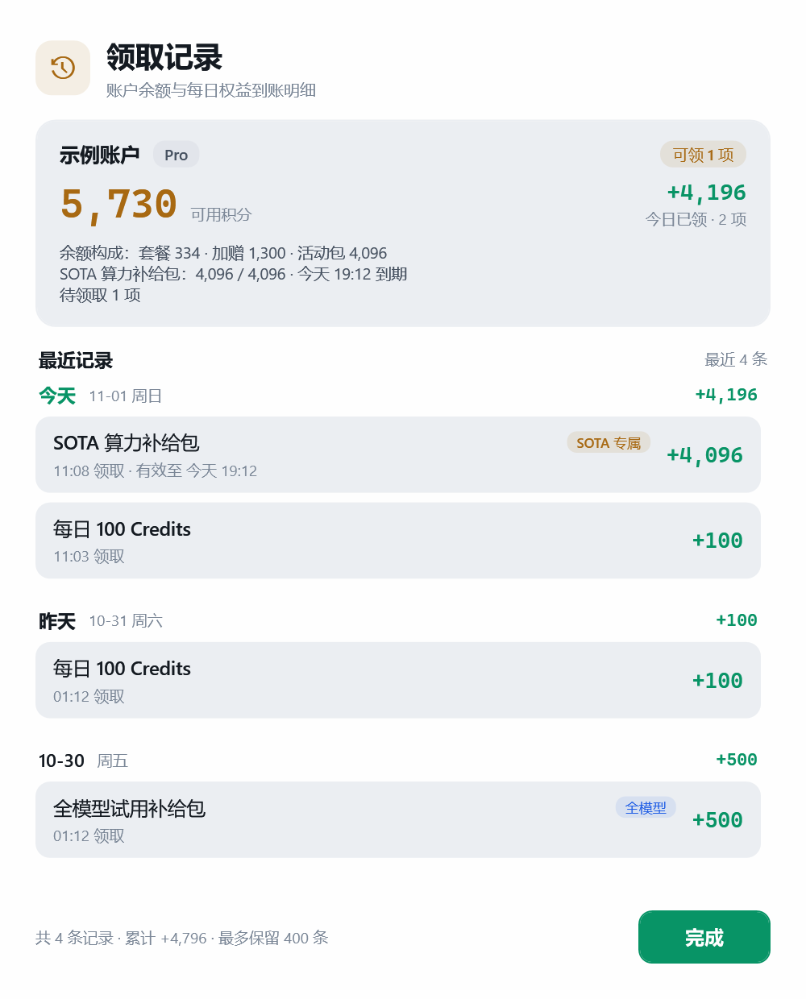<br>领取记录：账户摘要、当天合计与按天明细</td>
    <td align="center">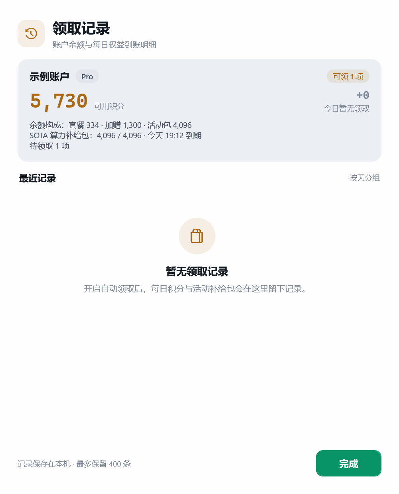<br>空状态：说明记录来源与自动领取</td>
  </tr>
</table>

设置窗口保持 450×760 的可滚动结构，账户、用量统计、外观、字段与会话各成一张卡片；「本地用量统计」在打开按钮旁提供不联网的迷你趋势预览，修改即时生效。右下的“完成”只关闭窗口，不提交额外更改。领取记录只读取本机 `claims.json`，打开窗口不会查询账户或触发领取，按 UTC+8 的 10:00 权益周期划分“今天 / 昨天”，最多展示最近 40 条，底部汇总本机全部记录；窗口打开期间若自动领取新增记录，列表会随刷新循环更新，无需重开。旧记录超过 400 条时由账本自动裁剪。

以上截图由当前源码的真实 WPF 控件在离线夹具中以 2× 渲染。会话名称、余额、有效期和领取数均为示例，不代表真实账户；截图也不证明实际停靠、多屏和网络请求已经通过实测。完整统计卡片保持既有网格排版，不增加条形字段分隔线。

### 图文用量统计

<table>
  <tr>
    <td align="center">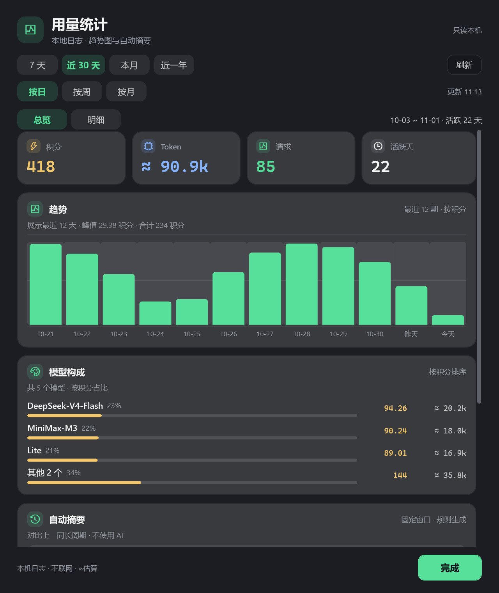<br>总览：摘要卡与趋势图</td>
    <td align="center">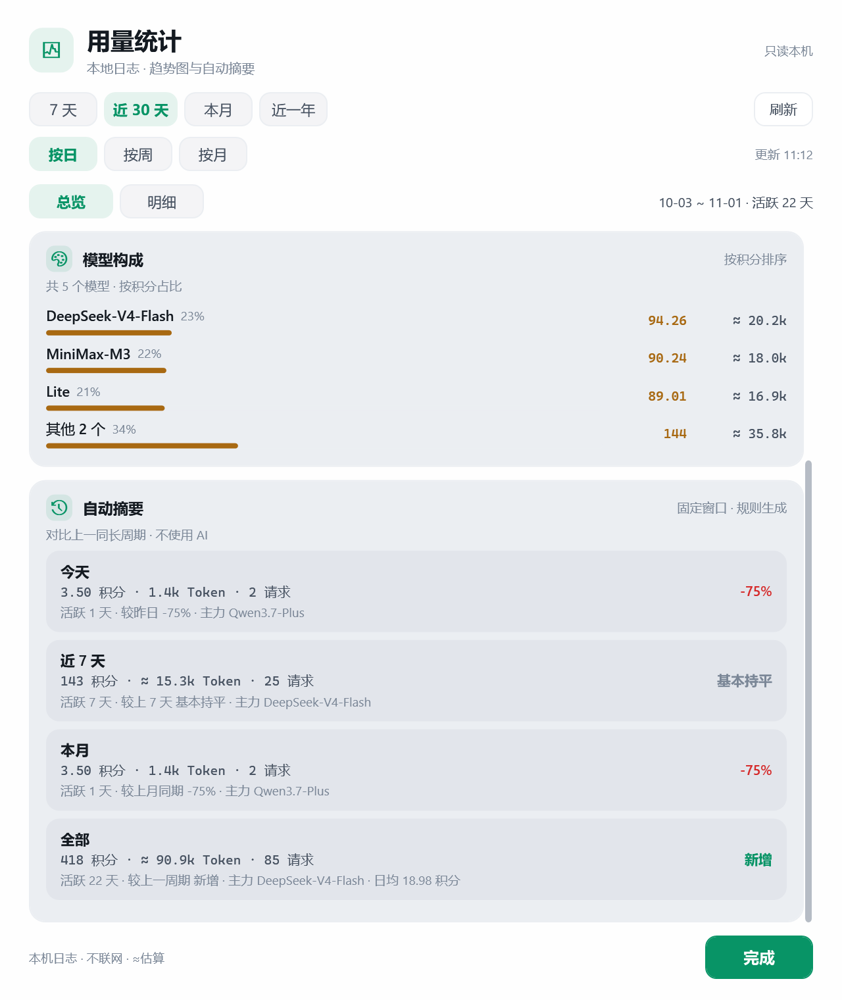<br>模型占比与自动摘要</td>
  </tr>
  <tr>
    <td align="center">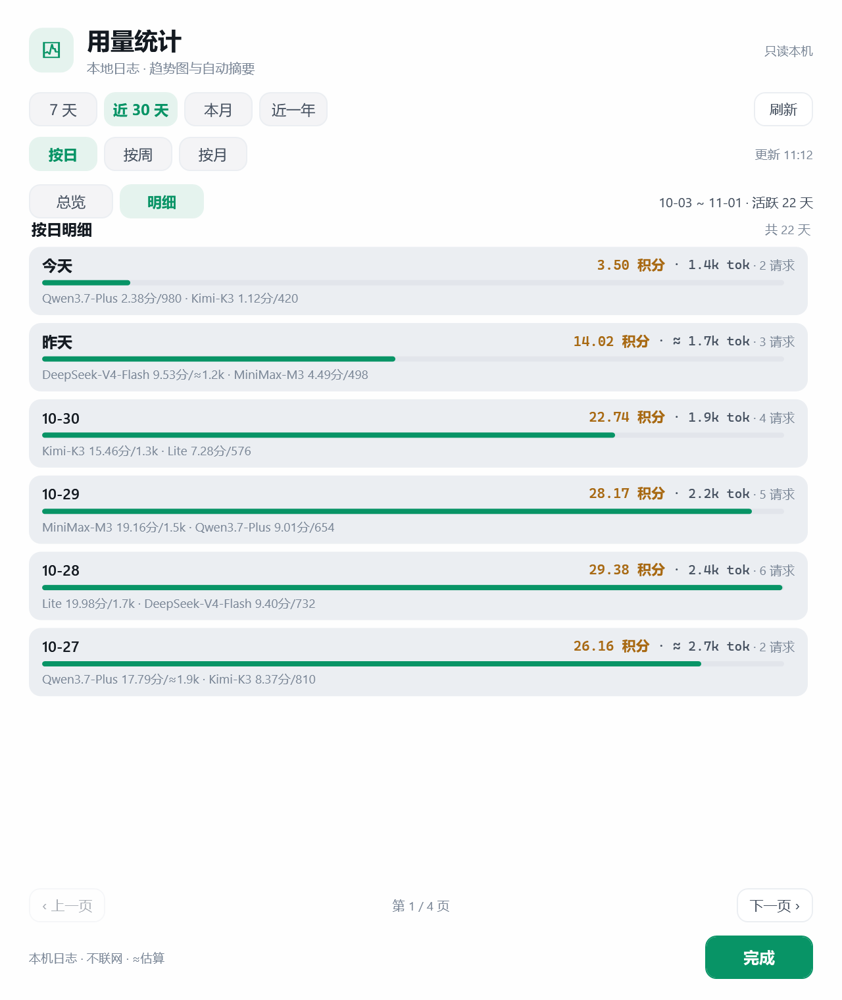<br>明细：逐期条形与分页</td>
    <td align="center">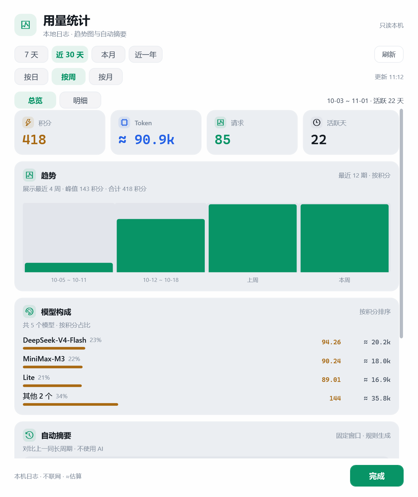<br>按周聚合</td>
  </tr>
</table>

统计窗口默认进入总览。四张摘要卡显示当前范围，趋势图最多展示最近 12 期；模型构成按积分占比，积分合计为 0 时改用 Token 占比。自动摘要固定分析今天、近 7 天、本月和全部，并与紧邻的等长周期比较；这些结论由本机规则生成，不调用 AI，也不联网。明细每页 6 期，行内显示相对峰值的条形和主要模型。日期、模型和金额均为离线夹具示例。

### 图文菜单：深色 / 浅色

<table>
  <tr>
    <td align="center">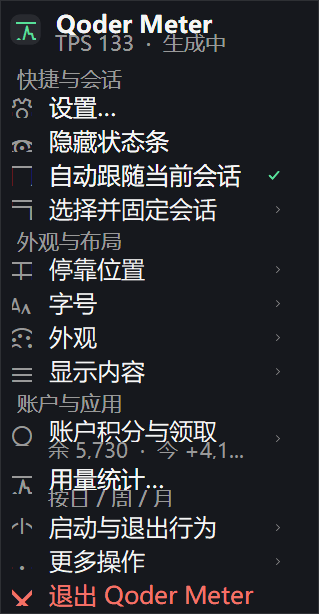<br>石墨主题</td>
    <td align="center">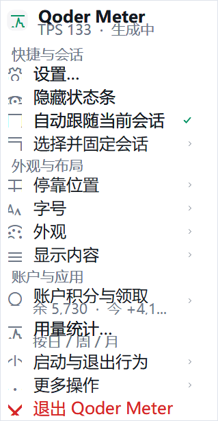<br>纸白主题</td>
  </tr>
</table>

### Windows 专用细分

<table>
  <tr>
    <td align="center">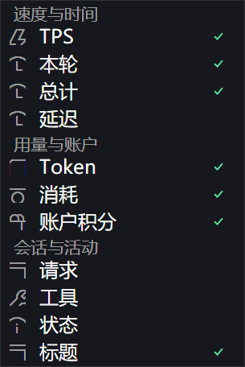<br>字段分类与独立勾选</td>
    <td align="center">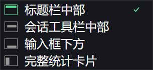<br>停靠位置示意图<br><br><br>账户摘要与领取操作</td>
  </tr>
</table>

菜单图片使用真实 WinForms 控件的隐藏 `DrawToBitmap` 离线渲染，展示 1× / 96 DPI 布局与模拟数据；不包含系统弹出阴影，也不代表真实弹出定位、焦点、键盘操作和跨显示器 DPI 切换已经验收。

## 安装与启动

开发验证环境：Windows 11、Qoder Desktop 0.4.11。Windows 10 2004+ 需可用的 winsqlite3 / JSON1，尚未独立完成实机验收。

> **账户行为提示**：源码默认开启自动领取。启动后，若本机 Qoder 登录态有效，会查询余额和活动并尝试领取可领权益。可以在设置关闭自动领取；关闭后仍保留账户查询。不存在“完全不联网”的设置开关。

```powershell
git clone --branch restructure https://github.com/chenleshu/qoder-meter.git
cd qoder-meter\windows
powershell -NoProfile -ExecutionPolicy Bypass -File install.ps1 -NoAutoStart -StartNow
```

- 安装目录：`%LOCALAPPDATA%\QoderMeter\app`。
- 设置、日志、领取记录与统计缓存：`%APPDATA%\QoderMeter`。
- `-NoAutoStart` 不新增启动守护，保留原有自启动设置；`-StartNow` 安装后启动。省略 `-StartNow` 可稍后手动打开。
- 不传 `-NoAutoStart` 的安装流程会启用随 Qoder 自动启动。也可在设置中开启或关闭该选项。
- 不安装也可双击源码目录的 `启动 Qoder 状态条.cmd`。安装副本与源码是独立文件，修改源码不会自动更新已安装副本。

更新已安装版本时重新执行安装命令；勿只重启旧安装副本并期待它加载新的源码。

## 布局与交互

| 布局 | 适用场景 |
| --- | --- |
| 标题栏中部 | 默认推荐，减少遮挡会话列表 |
| 会话工具栏中部 | 当前会话工具栏有足够空白时使用 |
| 输入框下方 | 关注输入区附近的状态；空间不足可收起 |
| 完整统计卡片 | 固定 246 DIP 宽，集中显示会话摘要和账户状态 |

- 条形布局横向拖动微调，卡片顶部自由拖动。每个位置独立记忆偏移，“重置当前位置”只影响当前视图。
- 五套配色：纸白、石墨、海盐、暮色、暖砂；另有自动外观。条形视图支持四档字号和逐字段开关，卡片不受这些开关和字号影响。
- 条形视图按字段内容使用自然宽度，不再为数字预留空列；数字变长时只扩展到实际需要，仍不超过窗口可用空间。默认关闭状态、工具、请求，其余字段可在菜单中逐项开关，完整内容仍保留在悬停提示中。
- 窄空间按优先级保留 Token 等指标并优先收起状态胶囊；账户积分胶囊是唯一的余额展示，仅在固定端点本身放不下时收起。隐藏内容仍可在悬停提示中查看。空间严重不足时收成细线，悬停展开，移出约 1.5 秒收起。
- 点击齿轮进入设置，点击齿轮左侧的图表入口打开用量统计；左键点击托盘图标也可进入设置。右键状态条 / 托盘打开图文菜单。设置即时保存。
- 统计窗口、托盘「用量统计…」和设置「本地用量统计 → 打开统计」共用同一入口。范围、粒度与总览 / 明细视图分别保存；打开窗口复用 10 分钟内缓存，点击「刷新」才会重新扫描本机日志。
- 自动跟随当前打开的会话，也可从最近会话中选择并固定；支持刷新、显示 / 隐藏和位置重置。
- Qoder 非前台或最小化时隐藏；可随 Qoder 退出。手动退出仅抑制当前 Qoder 进程生命周期内的自动拉起。

### 图文弹出菜单

右键状态条与托盘使用同一套原生 Windows 菜单，保留方向键导航、子菜单、禁用状态与勾选反馈，不用网页替代菜单。

| 分组 | 内容 |
| --- | --- |
| 快捷与会话 | 设置、显示 / 隐藏、自动跟随、选择并固定会话；长标题可悬停查看 |
| 外观与布局 | 四种 Windows 停靠位置示意图、字号、主题色块、分类字段开关 |
| 账户与应用 | 余额和今日领取摘要、领取与历史、本地用量统计、启动行为、更多操作和退出 |

「显示内容」细分为 **速度与时间**（TPS、本轮、总计、延迟）、**用量与账户**（Token、消耗、账户积分）、**会话与活动**（请求、工具、状态、标题）。余额只由账户积分胶囊展示，不再单独占用一个条形字段。卡片模式下提示字段开关只影响条形布局。

「随 Qoder 自动启动」「Qoder 退出时关闭」移入「启动与退出行为」；「立即刷新」「重置当前位置」「打开设置目录」集中在「更多操作」。账户摘要只展示当前缓存，打开菜单本身不会触发领取。

## 账户积分与权益

### 余额与今日领取

正常情况下账户胶囊显示 `余 5,730 · 今 +4,096`。当天没有本机领取记录时显示 `今 +0`，不再显示“今日未领取”。待领、领取中、未登录、账户异常等状态仍会优先替换胶囊文案。

余额来自官方账户接口，汇总套餐剩余、加赠包剩余及有效活动包剩余。悬停或打开设置可查看构成与有效期。**活动包可能仅适用于指定模型，合计余额不等于所有模型都可用的积分。**

“今日”按 **UTC+8 每天 10:00** 切换权益周期，只统计 Meter 在本机记录的领取，不代表浏览器、其他设备或其他工具上的完整领取记录。

### 领取行为

- 查询 `GET /sash/api/v1/me/campaigns`，仅领取 `CLAIM_BENEFIT` 类型且状态为 `CLAIMABLE` 的权益，逐项调用官方 claim 接口。
- 该接口有时会对 Meter 返回成功但空的活动列表（Qoder 内仍能看到可领权益）。此时回退只读解析 Qoder 本地 HTTP 缓存中的同一接口响应，用其中的可领项补齐；缓存结果最多沿用 5 分钟，并按活动起止时间过滤过期项。
- 同一天已记录领取的活动不会重复提交；接口返回 `replayed` 也按已领取记录。设置可切换自动领取，或点击“立即领取全部”。自动领取由刷新循环触发，并非只在会话空闲时触发。
- 成功提示会列出权益名称、积分和可用范围；最多保存 400 条本机记录，历史窗口展示近期记录。
- 余额通常每 30 秒、活动通常每 60 秒读取一次。空活动列表也会缓存；网络失败退避约 60 秒，领取失败的权益自动重试冷却约 15 分钟。手动领取不受自动冷却限制。
- 所有权益都处于冷却中时，不因本轮跳过领取而反复清空活动缓存。

账户记录尚未按账号隔离，频繁切换账号时需注意历史与缓存的归属；不要将本机累计值视为跨账号账单。自动领取开关关闭后只停止后续自动领取，不撤回已经领取的权益。

### 认证与隐私

本机 Qoder 的安全存储提供登录令牌；Meter 不保存账号密码，令牌不写入日志或自身配置，只在内存中使用并随认证请求发往 `openapi.qoder.sh`。为补齐活动列表，会以共享只读方式解析 Qoder 的 HTTP 缓存文件，仅提取其中的 campaigns 响应，不复制或上传其他缓存内容。会话标题、内容、Token 和本地日志不上传。本地用量统计只读会话 JSONL，不接触令牌，也不发起网络请求。

登录态不可用时提示重新登录 Qoder。账户查询和领取目前是同步请求，网络慢时可能暂时阻塞界面；这是当前实现限制，不是分隔线功能导致。

## 本地用量统计

状态条齿轮左侧的图表入口、托盘「用量统计…」或设置中的「本地用量统计 → 打开统计」都会打开同一独立窗口。它只读取 `~/.qoder/projects/**/*.jsonl`，不访问账户接口、不上传数据；统计窗口未打开时不会进行扫描。

- **范围**：7 天（含今天的 7 个自然日）、近 30 天（含今天 30 天）、本月（当月 1 日至今天）、近一年（含今天 365 天），按本机日期切分。
- **粒度**：按日、按周（周一至周日）、按月（自然月）。切换范围或粒度回到第一页，范围、粒度和总览 / 明细视图都写入 `%APPDATA%\QoderMeter\settings.json`，下次打开沿用。
- **口径**：只统计 `type=assistant` 且 `message.usage.credits` 有值的助手记录；带 `request_id` 的请求在全部日志中只计一次。积分取日志中的本地 Credits；Token 优先使用 input、cache read、cache creation 与 output 之和，四项都为 0 时才按内容估算（CJK / 1.35 + 其他字符 / 3.8），含估算值的 Token 数字带 `≈`。请求数按同一筛选口径累计，不等于官方用量页的请求统计。
- **总览**：四张摘要卡显示当前范围的积分、Token、请求和活跃天；趋势图按当前粒度展示最多最近 12 期，柱子以积分归一并保留完整悬停信息；模型构成显示积分占比，积分合计为 0 时改用 Token 占比。自动摘要固定分析今天、近 7 天、本月和全部，与紧邻的等长周期比较；上期无记录时显示“新增”，没有当前记录时显示“暂无用量记录”，不调用 AI。
- **明细**：每页 6 期，行内按当前范围峰值绘制条形，并显示主要模型；按日显示请求数，按周 / 月显示有记录的天数，悬停可查看完整日期范围、积分、Token 和请求数。
- **缓存与刷新**：扫描结果写入 `%APPDATA%\QoderMeter\stats-cache.json`，10 分钟内复用；点击「刷新」强制重扫。缓存版本不符或整体无法解析时自动丢弃并重建，非法日期条目会被跳过。统计窗口打开期间不会后台轮询，需要刷新才会看到新会话。
- **边界**：只覆盖本机仍保留的会话日志，清理、迁移或压缩日志后历史会减少；按本机日期而不是账户权益周期；本地 Credits 与估算 Token 不是官方账单，不能用于对账；首次扫描较大的日志目录可能短暂卡顿。日志目录或个别文件不可读时，窗口保留已聚合部分，并在脚注提示检查权限。

## 数据与口径

| 数据 | 来源与解释 |
| --- | --- |
| 会话、标题、模型、创建时间 | Qoder 本地 `main.sqlite` |
| 当前打开会话 | Qoder `Local Storage\leveldb` 中的路由信息 |
| 消耗、请求、工具、输出量 | `~/.qoder/projects/…/<session>.jsonl` |
| 用量统计的积分、Token、请求 | 同目录下带 `usage.credits` 的助手记录；同一 `request_id` 只计一次 |
| 统计缓存 | `%APPDATA%\QoderMeter\stats-cache.json`，10 分钟 TTL，刷新时重扫 |
| 本轮与最近请求耗时 | `~/.qoder/logs/sessions/…/segments/*.jsonl` |
| 账户余额 | 官方 `GET /sash/api/v2/me/usage` |
| 本机领取历史 | `%APPDATA%\QoderMeter\claims.json` |

TPS 为本轮匹配输出 / 模型请求耗时，不是瞬时速度。“总计”是会话创建至今，不是累计工作时长；“延迟”是最近请求耗时，不是首 Token 延迟。

输出估算包含文本、思考和工具参数，采用 `CJK / 1.35 + 其他字符 / 3.8`；缺少精确输出时显示 `≈`。当前混合精确和估算数据的会话优先展示已有精确累计部分，不能视为完整精确总量。用量统计按请求判断：四项用量合计大于 0 时使用精确值，只有全部为 0 才估算该条记录；因此同一范围的 Token 与状态条读数可能不同。积分来自本地账单，不应通过估算 Token 反推官方计费。

Qoder 文件均为只读。Meter 自己的设置、日志、实例状态、统计缓存和领取记录写入自身数据目录。

## 开发与验证

直接运行源码：

```powershell
powershell -NoProfile -STA -ExecutionPolicy Bypass -File src\meter.ps1
```

可选参数：`-Layout title|toolbar|bottom|sidebar`、`-Pin <session-id>`、`-AlwaysOn`、`-NoTray`。实例为单例；停止时使用 `src\stop.ps1`，它会核验进程与脚本路径。

离线回归使用模拟接口、临时目录或只读数据，不触发真实领取：

```powershell
powershell -NoProfile -ExecutionPolicy Bypass -File tools\parse-check.ps1
powershell -NoProfile -STA -ExecutionPolicy Bypass -File probe\ui-regression.ps1 -Full
powershell -NoProfile -STA -ExecutionPolicy Bypass -File probe\settings-regression.ps1
powershell -NoProfile -STA -ExecutionPolicy Bypass -File probe\claims-regression.ps1
powershell -NoProfile -STA -ExecutionPolicy Bypass -File probe\interaction-regression.ps1
powershell -NoProfile -STA -ExecutionPolicy Bypass -File probe\menu-regression.ps1
powershell -NoProfile -ExecutionPolicy Bypass -File probe\account-regression.ps1
powershell -NoProfile -ExecutionPolicy Bypass -File probe\stats-regression.ps1
powershell -NoProfile -STA -ExecutionPolicy Bypass -File probe\stats-window-regression.ps1
powershell -NoProfile -STA -ExecutionPolicy Bypass -File probe\data-regression.ps1
powershell -NoProfile -ExecutionPolicy Bypass -File probe\lifecycle-test.ps1
```

`data-regression` 的 JSON 序列化对照需要 Node；这是开发测试依赖，不是应用运行依赖。`ui-regression -Full` 覆盖分隔线归属、字段开关、五套主题、四档字号和窄—宽—窄布局稳定性，并检查短—长—短内容切换时外框、列位置与字段显隐不变，以及 100% / 125% / 150% / 200% 模拟 DPI 下的布局取整与边界。模拟 DPI 不等于真实多屏停靠验收。

`menu-regression` 使用内存账户与会话夹具，覆盖菜单分组、原操作分发、字段开关、长标题、账户状态、五套主题与六种比例的几何边界，以及图标和勾选的独立绘制；不会启动主程序或访问真实账户。

`claims-regression` 使用临时账本与内存账户夹具，覆盖领取记录的窗口尺寸、主题资源、余额与今日合计、按天从新到旧排序、空状态、未登录 / 读取失败状态、累计口径，以及打开历史不写账本、不发起网络请求。夹具不入库。

`stats-regression` 使用临时 JSONL、临时缓存目录与固定日期夹具，当前 127 项覆盖扫描筛选、`request_id` 去重、范围边界、模型合并、估算标记、缓存过期与损坏自愈、周 / 月分组、趋势序列、模型占比、四条自动摘要、空状态和配置校验；不读取真实日志或账户，不发起网络请求。`stats-window-regression` 构建真实 WPF 统计窗口，当前 103 项覆盖范围 / 粒度 / 视图按钮、摘要卡、趋势柱、模型占比、自动摘要、明细分页、空状态和错误脚注、主题重建与关闭行为；窗口不调用 `Show`，不会显示到桌面。

重新生成截图（从 `windows` 目录执行）：

```powershell
New-Item -ItemType Directory -Force docs\screenshots | Out-Null
powershell -NoProfile -STA -ExecutionPolicy Bypass -File probe\render-ui.ps1 -OutputDirectory docs\screenshots
powershell -NoProfile -STA -ExecutionPolicy Bypass -File probe\render-menu.ps1 -OutputDirectory docs\screenshots
```

渲染脚本使用真实控件与示例数据，不打开正常主窗口、不读取真实账号、不触发网络请求。`render-menu` 输出深浅两种主题的主菜单、停靠位置、字段分类及账户子菜单共八张 PNG；`render-ui` 同时输出设置界面的深浅两套、账本与空状态的领取记录、用量统计的总览 / 自动摘要 / 明细 / 按周 / 空状态，以及各布局、悬停卡片和紧凑宽度对照图。为 `render-ui` 添加 `-StableWidthOnly` 可只渲染短、正常和超长内容的紧凑宽度图。PowerShell 脚本须保留 **UTF-8 BOM**，以兼容 Windows PowerShell 5.1。

## 已知边界

- 停靠按 Qoder 0.4.11 默认布局适配，不是客户端原生插槽；侧栏宽度、长标题、客户端缩放变化后可能需要调整位置。
- 几何计算覆盖负坐标及 DPI，但混合缩放多显示器尚需硬件验收；自动跟随依赖全局路由，多窗口并不保证总能匹配当前焦点会话。
- 自动外观优先读取应用图标的 resolvedAppearance，并不保证等于编辑区主题；可手动选皮肤。
- 中国区客户端及非 ASCII 数据路径尚未完整验证。客户端数据结构升级可能需要更新解析。
- 账户缓存的更新时间、部分领取失败反馈、混合 Token 口径仍有改善空间；不可将界面缓存当作实时官方账单。
- 用量统计只覆盖本机仍保留的会话日志，且窗口打开后不自动轮询；大目录首次扫描可能短暂卡顿，刷新才会重扫。统计不区分账号，本地 Credits 与估算 Token 不能作为官方账单。自动摘要和趋势只使用当前缓存中的合法日期，不调用 AI，也不代表跨设备或已删除日志的完整历史。
- 检查更新只由手动操作触发，不自动下载安装；本分支的新源码功能可能尚未包含在 Release 中。
- 旧的 `try-layout.ps1` 等探针包含过时进程匹配，不用于本版验收。不要用它们停止进程。

## 文件组织

`src/meter.ps1` 为主入口；`lib-ui` 构建状态条、卡片与统计 / 设置图标入口；`lib-menu` 绘制原生图文菜单；`lib-settings` 管理设置；`lib-config-layout` 管理配置与几何；`lib-data` 解析本地数据；`lib-stats` 扫描用量日志、聚合趋势与自动摘要并构建图文统计窗口；`lib-account` 管理账号接口和领取；`lib-lifecycle`、`watch`、`stop` 管理生命周期；`lib-interop` 封装系统 DLL。

[MIT License](../LICENSE)。
