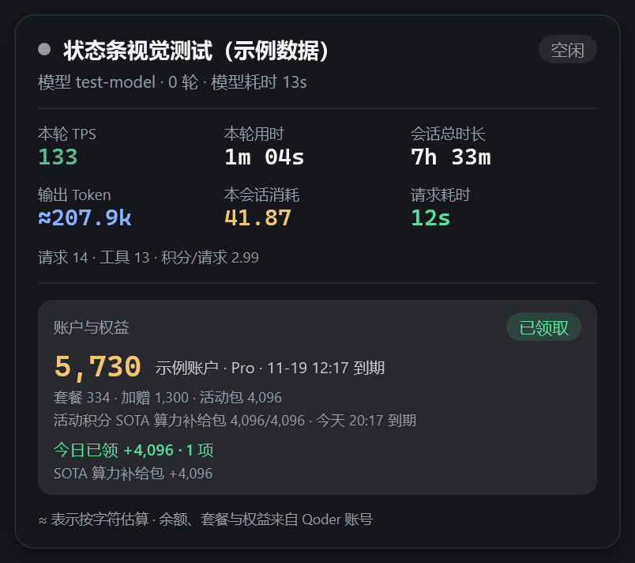
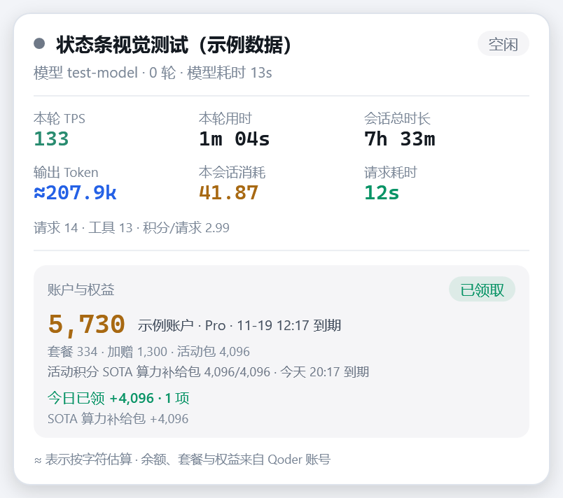
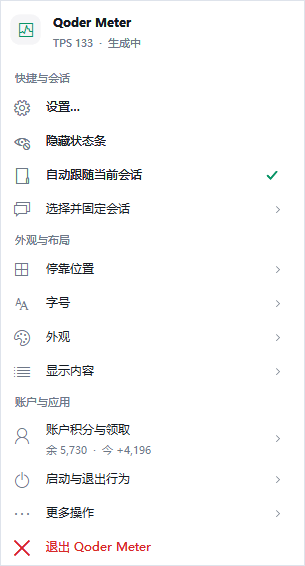
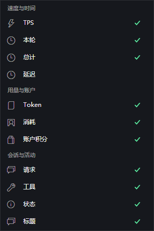

# Qoder Meter for Windows

Windows PowerShell 5.1 + WPF 编写的 Qoder Desktop 伴生状态条。无需 Node / Python 运行时，不修改 Qoder 客户端。[返回项目首页](../README.md) · [macOS 版](../macos/README.md)

## 本次更新

1. 条形布局的指标、状态和账户胶囊之间加入 **1 DIP 细竖线**：高度随字号变化，使用主题灰色的 35% 不透明度，避免抢占数字的视觉重点。
2. 分隔线属于其右侧字段，字段关闭或因空间不足隐藏时会一起移除；所有字段关闭时不残留分隔线，设置按钮后不出现尾线。
3. 账户功能内置到 `lib-account.ps1`，正常状态显示剩余积分与本机今日领取；无需外部领取脚本。
4. 补充空活动列表缓存、领取失败冷却的回归，整理功能说明与离线截图。
5. Windows 右键与托盘菜单改为图文分组：系统线性图标、停靠位置示意图、主题色块和账户摘要，深浅配色随皮肤切换；字段开关进一步分成速度与时间、用量与账户、会话与活动三组。
6. 条形宽度按字号与字段开关预留固定容量，不再随数字位数、会话标题、生成状态或账户文案伸缩；仅空间、布局、字号、字段或 DPI 改变时重算，超长内容在自身槽位省略。
7. 条形排版整体收紧：高度由 30 DIP 降到 26 DIP，缩小字段间距、分隔线间距、状态灯与胶囊内边距和设置按钮；状态胶囊只保留“生成中 / 本轮中 / 空闲 / 等待会话”，计时移入悬浮卡片，避免空闲时出现大片空白胶囊。保留原有固定槽位，宽度依旧不随内容跳动。
8. 关键指标自动着色：TPS 生成中为亮绿、空闲降为暗绿；输出 Token 使用主题蓝，本会话消耗使用主题金；请求耗时按 15 秒 / 30 秒分为绿、金、红三档，账户与领取状态沿用绿、金、红语义色。
9. 悬停详情改为与主界面同风格的主题卡片：状态圆点、会话标题与状态胶囊、模型信息、六格关键指标、请求汇总、账户余额与构成、活动包、今日领取明细和提示脚注；深浅皮肤、字号和 DPI 同步，更新时原位刷新文字与颜色，不重建弹层。

应用内版本号仍为 `1.4.0-win.3`；当前为源码更新，未单独生成新的 Release 安装包。

## 界面预览

### 标题栏：深色 / 浅色


### 窄空间：保留核心字段


### 稳定宽度：短内容 → 超长内容


两图使用同一主题、同一字段配置和 689 DIP 可用空间，外宽均为 640 DIP；短值、空值和超长数字只替换槽位内文字，超长值在自身槽位省略，相邻字段不移动。完整内容仍保留在悬停卡片中。

### 悬停详情：主题化卡片

<table>
  <tr>
    <td align="center"><br>石墨主题</td>
    <td align="center"><br>纸白主题</td>
  </tr>
</table>

卡片把指标、账户与领取信息分层排版：六格关键指标自动配色，账户区单独使用浅色底板，余额、套餐构成、活动包、今日领取与领取状态各占一行。窄空间隐藏的字段仍在此完整显示。

### 完整卡片与账户设置

<table>
  <tr>
    <td width="40%" align="center"><br>会话统计与账户摘要</td>
    <td width="60%" align="center"><br>余额明细、领取与历史入口</td>
  </tr>
</table>

以上截图由当前源码的真实 WPF 控件在离线夹具中以 2× 渲染。会话名称、余额、有效期和领取数均为示例，不代表真实账户；截图也不证明实际停靠、多屏和网络请求已经通过实测。完整统计卡片保持既有网格排版，不增加条形字段分隔线。

### 图文菜单：深色 / 浅色

<table>
  <tr>
    <td align="center"><br>石墨主题</td>
    <td align="center"><br>纸白主题</td>
  </tr>
</table>

### Windows 专用细分

<table>
  <tr>
    <td align="center"><br>字段分类与独立勾选</td>
    <td align="center"><br>停靠位置示意图<br><br><br>账户摘要与领取操作</td>
  </tr>
</table>

菜单图片使用真实 WinForms 控件的隐藏 `DrawToBitmap` 离线渲染，展示 1× / 96 DPI 布局与模拟数据；不包含系统弹出阴影，也不代表真实弹出定位、焦点、键盘操作和跨显示器 DPI 切换已经验收。

## 安装与启动

开发验证环境：Windows 11、Qoder Desktop 0.4.11。Windows 10 2004+ 需可用的 winsqlite3 / JSON1，尚未独立完成实机验收。

> **账户行为提示**：源码默认开启自动领取。启动后，若本机 Qoder 登录态有效，会查询余额和活动并尝试领取可领权益。可以在设置关闭自动领取；关闭后仍保留账户查询。不存在“完全不联网”的设置开关。

```powershell
git clone --branch restructure https://github.com/chenleshu/qoder-meter.git
cd qoder-meter\windows
powershell -NoProfile -ExecutionPolicy Bypass -File install.ps1 -NoAutoStart -StartNow
```

- 安装目录：`%LOCALAPPDATA%\QoderMeter\app`。
- 设置、日志与领取记录：`%APPDATA%\QoderMeter`。
- `-NoAutoStart` 不新增启动守护，保留原有自启动设置；`-StartNow` 安装后启动。省略 `-StartNow` 可稍后手动打开。
- 不传 `-NoAutoStart` 的安装流程会启用随 Qoder 自动启动。也可在设置中开启或关闭该选项。
- 不安装也可双击源码目录的 `启动 Qoder 状态条.cmd`。安装副本与源码是独立文件，修改源码不会自动更新已安装副本。

更新已安装版本时重新执行安装命令；勿只重启旧安装副本并期待它加载新的源码。

## 布局与交互

| 布局 | 适用场景 |
| --- | --- |
| 标题栏中部 | 默认推荐，减少遮挡会话列表 |
| 会话工具栏中部 | 当前会话工具栏有足够空白时使用 |
| 输入框下方 | 关注输入区附近的状态；空间不足可收起 |
| 完整统计卡片 | 固定 246 DIP 宽，集中显示会话摘要和账户状态 |

- 条形布局横向拖动微调，卡片顶部自由拖动。每个位置独立记忆偏移，“重置当前位置”只影响当前视图。
- 五套配色：纸白、石墨、海盐、暮色、暖砂；另有自动外观。条形视图支持四档字号和逐字段开关，卡片不受这些开关和字号影响。
- 条形视图按字号和字段开关预留稳定宽度，不再随数字位数、会话标题、生成状态或账户文案忽长忽短；超长内容省略显示，完整内容仍保留在悬停提示中。仅窗口可用空间、布局、字号、字段开关或 DPI 改变时重新适配。
- 窄空间按优先级保留 Token 等指标并优先收起状态胶囊；账户积分胶囊是唯一的余额展示，仅在固定端点本身放不下时收起。隐藏内容仍可在悬停提示中查看。空间严重不足时收成细线，悬停展开，移出约 1.5 秒收起。
- 点击齿轮或左键点击托盘进入设置；右键状态条 / 托盘打开菜单。设置即时保存。
- 自动跟随当前打开的会话，也可从最近会话中选择并固定；支持刷新、显示 / 隐藏和位置重置。
- Qoder 非前台或最小化时隐藏；可随 Qoder 退出。手动退出仅抑制当前 Qoder 进程生命周期内的自动拉起。

### 图文弹出菜单

右键状态条与托盘使用同一套原生 Windows 菜单，保留方向键导航、子菜单、禁用状态与勾选反馈，不用网页替代菜单。

| 分组 | 内容 |
| --- | --- |
| 快捷与会话 | 设置、显示 / 隐藏、自动跟随、选择并固定会话；长标题可悬停查看 |
| 外观与布局 | 四种 Windows 停靠位置示意图、字号、主题色块、分类字段开关 |
| 账户与应用 | 余额和今日领取摘要、领取与历史、启动行为、更多操作和退出 |

「显示内容」细分为 **速度与时间**（TPS、本轮、总计、延迟）、**用量与账户**（Token、消耗、账户积分）、**会话与活动**（请求、工具、状态、标题）。余额只由账户积分胶囊展示，不再单独占用一个条形字段。卡片模式下提示字段开关只影响条形布局。

「随 Qoder 自动启动」「Qoder 退出时关闭」移入「启动与退出行为」；「立即刷新」「重置当前位置」「打开设置目录」集中在「更多操作」。账户摘要只展示当前缓存，打开菜单本身不会触发领取。

## 账户积分与权益

### 余额与今日领取

正常情况下账户胶囊显示 `余 5,730 · 今 +4,096`。当天没有本机领取记录时显示 `今 +0`，不再显示“今日未领取”。待领、领取中、未登录、账户异常等状态仍会优先替换胶囊文案。

余额来自官方账户接口，汇总套餐剩余、加赠包剩余及有效活动包剩余。悬停或打开设置可查看构成与有效期。**活动包可能仅适用于指定模型，合计余额不等于所有模型都可用的积分。**

“今日”按 **UTC+8 每天 10:00** 切换权益周期，只统计 Meter 在本机记录的领取，不代表浏览器、其他设备或其他工具上的完整领取记录。

### 领取行为

- 查询 `GET /sash/api/v1/me/campaigns`，仅领取 `CLAIM_BENEFIT` 类型且状态为 `CLAIMABLE` 的权益，逐项调用官方 claim 接口。
- 该接口有时会对 Meter 返回成功但空的活动列表（Qoder 内仍能看到可领权益）。此时回退只读解析 Qoder 本地 HTTP 缓存中的同一接口响应，用其中的可领项补齐；缓存结果最多沿用 5 分钟，并按活动起止时间过滤过期项。
- 同一天已记录领取的活动不会重复提交；接口返回 `replayed` 也按已领取记录。设置可切换自动领取，或点击“立即领取全部”。自动领取由刷新循环触发，并非只在会话空闲时触发。
- 成功提示会列出权益名称、积分和可用范围；最多保存 400 条本机记录，历史窗口展示近期记录。
- 余额通常每 30 秒、活动通常每 60 秒读取一次。空活动列表也会缓存；网络失败退避约 60 秒，领取失败的权益自动重试冷却约 15 分钟。手动领取不受自动冷却限制。
- 所有权益都处于冷却中时，不因本轮跳过领取而反复清空活动缓存。

账户记录尚未按账号隔离，频繁切换账号时需注意历史与缓存的归属；不要将本机累计值视为跨账号账单。自动领取开关关闭后只停止后续自动领取，不撤回已经领取的权益。

### 认证与隐私

本机 Qoder 的安全存储提供登录令牌；Meter 不保存账号密码，令牌不写入日志或自身配置，只在内存中使用并随认证请求发往 `openapi.qoder.sh`。为补齐活动列表，会以共享只读方式解析 Qoder 的 HTTP 缓存文件，仅提取其中的 campaigns 响应，不复制或上传其他缓存内容。会话标题、内容、Token 和本地日志不上传。

登录态不可用时提示重新登录 Qoder。账户查询和领取目前是同步请求，网络慢时可能暂时阻塞界面；这是当前实现限制，不是分隔线功能导致。

## 数据与口径

| 数据 | 来源与解释 |
| --- | --- |
| 会话、标题、模型、创建时间 | Qoder 本地 `main.sqlite` |
| 当前打开会话 | Qoder `Local Storage\leveldb` 中的路由信息 |
| 消耗、请求、工具、输出量 | `~/.qoder/projects/…/<session>.jsonl` |
| 本轮与最近请求耗时 | `~/.qoder/logs/sessions/…/segments/*.jsonl` |
| 账户余额 | 官方 `GET /sash/api/v2/me/usage` |
| 本机领取历史 | `%APPDATA%\QoderMeter\claims.json` |

TPS 为本轮匹配输出 / 模型请求耗时，不是瞬时速度。“总计”是会话创建至今，不是累计工作时长；“延迟”是最近请求耗时，不是首 Token 延迟。

输出估算包含文本、思考和工具参数，采用 `CJK / 1.35 + 其他字符 / 3.8`；缺少精确输出时显示 `≈`。当前混合精确和估算数据的会话优先展示已有精确累计部分，不能视为完整精确总量。积分来自本地账单，不应通过估算 Token 反推官方计费。

Qoder 文件均为只读。Meter 自己的设置、日志、实例状态和领取记录写入自身数据目录。

## 开发与验证

直接运行源码：

```powershell
powershell -NoProfile -STA -ExecutionPolicy Bypass -File src\meter.ps1
```

可选参数：`-Layout title|toolbar|bottom|sidebar`、`-Pin <session-id>`、`-AlwaysOn`、`-NoTray`。实例为单例；停止时使用 `src\stop.ps1`，它会核验进程与脚本路径。

离线回归使用模拟接口、临时目录或只读数据，不触发真实领取：

```powershell
powershell -NoProfile -ExecutionPolicy Bypass -File tools\parse-check.ps1
powershell -NoProfile -STA -ExecutionPolicy Bypass -File probe\ui-regression.ps1 -Full
powershell -NoProfile -STA -ExecutionPolicy Bypass -File probe\settings-regression.ps1
powershell -NoProfile -STA -ExecutionPolicy Bypass -File probe\interaction-regression.ps1
powershell -NoProfile -STA -ExecutionPolicy Bypass -File probe\menu-regression.ps1
powershell -NoProfile -ExecutionPolicy Bypass -File probe\account-regression.ps1
powershell -NoProfile -STA -ExecutionPolicy Bypass -File probe\data-regression.ps1
powershell -NoProfile -ExecutionPolicy Bypass -File probe\lifecycle-test.ps1
```

`data-regression` 的 JSON 序列化对照需要 Node；这是开发测试依赖，不是应用运行依赖。`ui-regression -Full` 覆盖分隔线归属、字段开关、五套主题、四档字号和窄—宽—窄布局稳定性，并检查短—长—短内容切换时外框、列位置与字段显隐不变，以及 100% / 125% / 150% / 200% 模拟 DPI 下的布局取整与边界。模拟 DPI 不等于真实多屏停靠验收。

`menu-regression` 使用内存账户与会话夹具，覆盖菜单分组、原操作分发、字段开关、长标题、账户状态、五套主题与六种比例的几何边界，以及图标和勾选的独立绘制；不会启动主程序或访问真实账户。

重新生成截图（从 `windows` 目录执行）：

```powershell
New-Item -ItemType Directory -Force docs\screenshots | Out-Null
powershell -NoProfile -STA -ExecutionPolicy Bypass -File probe\render-ui.ps1 -OutputDirectory docs\screenshots
powershell -NoProfile -STA -ExecutionPolicy Bypass -File probe\render-menu.ps1 -OutputDirectory docs\screenshots
```

渲染脚本使用真实控件与示例数据，不打开正常主窗口、不读取真实账号、不触发网络请求。`render-menu` 输出深浅两种主题的主菜单、停靠位置、字段分类及账户子菜单共八张 PNG。为 `render-ui` 添加 `-StableWidthOnly` 可单独渲染短、正常和超长内容的等宽对照图。PowerShell 脚本须保留 **UTF-8 BOM**，以兼容 Windows PowerShell 5.1。

## 已知边界

- 停靠按 Qoder 0.4.11 默认布局适配，不是客户端原生插槽；侧栏宽度、长标题、客户端缩放变化后可能需要调整位置。
- 几何计算覆盖负坐标及 DPI，但混合缩放多显示器尚需硬件验收；自动跟随依赖全局路由，多窗口并不保证总能匹配当前焦点会话。
- 自动外观优先读取应用图标的 resolvedAppearance，并不保证等于编辑区主题；可手动选皮肤。
- 中国区客户端及非 ASCII 数据路径尚未完整验证。客户端数据结构升级可能需要更新解析。
- 账户缓存的更新时间、部分领取失败反馈、混合 Token 口径仍有改善空间；不可将界面缓存当作实时官方账单。
- 检查更新只由手动操作触发，不自动下载安装；本分支的新源码功能可能尚未包含在 Release 中。
- 旧的 `try-layout.ps1` 等探针包含过时进程匹配，不用于本版验收。不要用它们停止进程。

## 文件组织

`src/meter.ps1` 为主入口；`lib-ui` 构建视图；`lib-menu` 绘制原生图文菜单；`lib-settings` 管理设置；`lib-config-layout` 管理配置与几何；`lib-data` 解析本地数据；`lib-account` 管理账号接口和领取；`lib-lifecycle`、`watch`、`stop` 管理生命周期；`lib-interop` 封装系统 DLL。

[MIT License](../LICENSE)。
